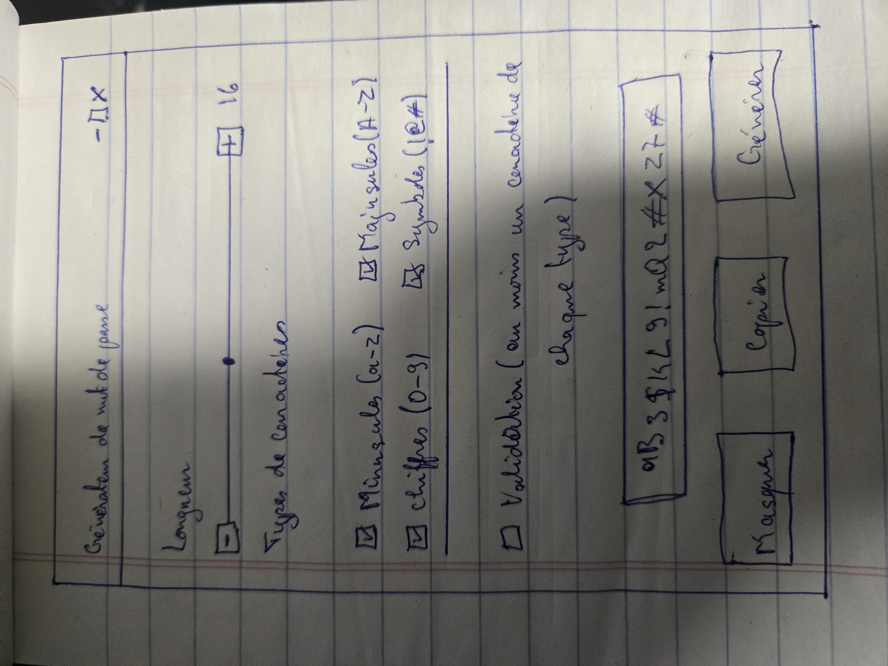
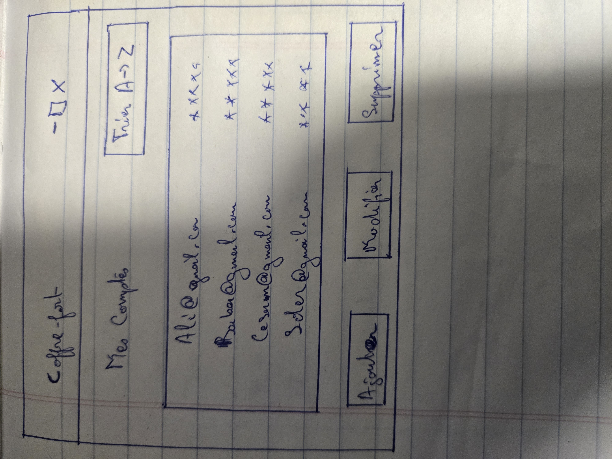

# Gestionnaire de mots de passe

TP1 du cours de programmation orientée objet II.

## Auteur

- Yao Denis Fiodegbekou (2515601), GitHub : yaodenisfiodegbekou-ops

## Description

Application de génération et de gestion de mots de passe, avec une interface en ligne de commande (partie 1) et une interface graphique PySide6 (partie 2).

## Installation

Prérequis : [uv](https://docs.astral.sh/uv/) et Python 3.12 ou plus récent.

```bash
git clone https://github.com/yaodenisfiodegbekou-ops/Tp1_2515601_YaoDenisFiodegbekou.git
cd Tp1_2515601_YaoDenisFiodegbekou
uv sync
```

## Utilisation (partie 1 : ligne de commande)

```bash
uv run main.py --no-gui
uv run main.py --no-gui --length 20 --validate
uv run main.py --no-gui --no-symbols --no-digits
```

| Argument | Description |
|---|---|
| `--length` | Longueur du mot de passe (16 par défaut) |
| `--no-lower` | Exclut les minuscules |
| `--no-upper` | Exclut les majuscules |
| `--no-digits` | Exclut les chiffres |
| `--no-symbols` | Exclut les symboles |
| `--validate` | Exige au moins un caractère de chaque type sélectionné |

## Utilisation (partie 2 : interface graphique)

```bash
uv run main.py
uv run main.py --vault_file mon_coffre.json
uv run main.py --no-gui --length 20 --validate
```

| Argument | Description |
|---|---|
| `--no-gui` | Lance seulement la ligne de commande de la partie 1 |
| `--vault_file` | Fichier JSON du coffre-fort (`vault.json` par défaut) |

### Fonctionnalités

- **Coffre-fort** : liste défilante des comptes, mots de passe masqués par défaut
- **Révéler** : double-clic ou clic droit sur une entrée (pendant 3 secondes)
- **Trier** : par e-mail, en ordre alphabétique
- **Ajouter / Modifier / Supprimer** : la suppression demande une confirmation, et le bouton Générer de la boîte d'ajout utilise la logique de la partie 1
- **Générateur** : longueur (slider et boutons -/+), types de caractères, validation, masquer/afficher, copier
- **Sauvegarde** : les entrées sont chargées au démarrage et sauvegardées dans le fichier JSON à la fermeture. Si le fichier est corrompu, un message s'affiche et l'application démarre avec un coffre-fort vide.

## Maquettes

### Fenêtre de génération



### Fenêtre du coffre-fort


